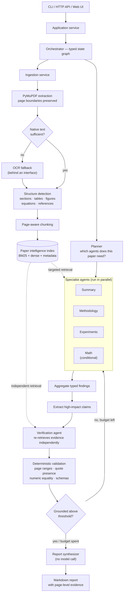
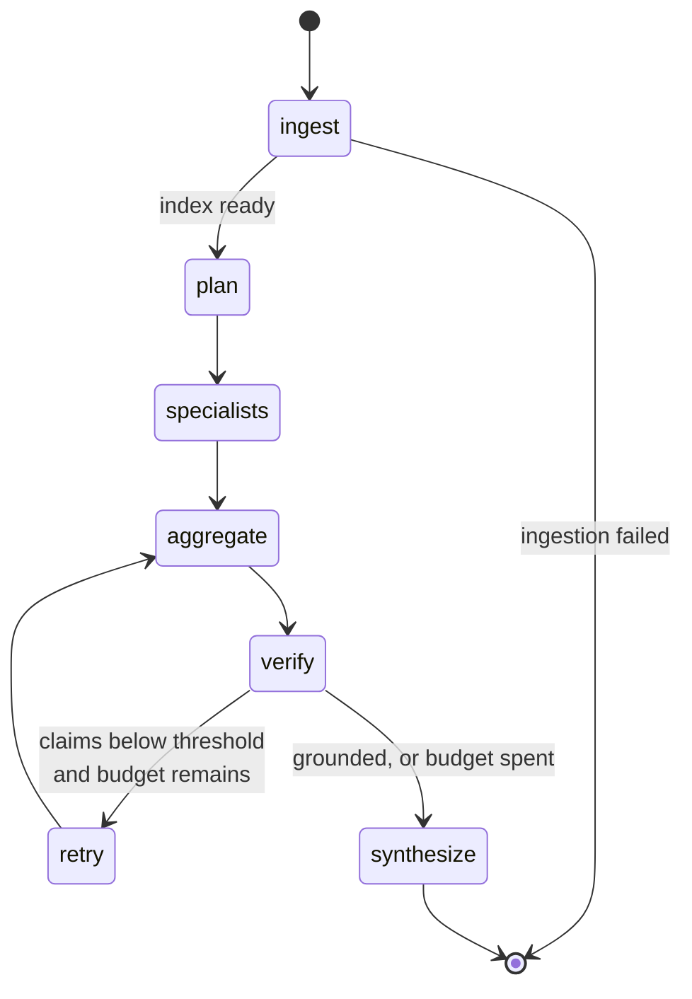

# PaperPilot

**A verifiable, citation-grounded, multi-agent system for analysing research papers.**

You give PaperPilot one research-paper PDF. It parses and indexes the paper with
page-level metadata, plans an analysis, runs specialist agents over *targeted*
evidence, verifies high-impact claims against the original text, retries the
analyses that failed to ground, and produces a Markdown report in which every
important statement is either backed by a quote that was re-checked against the
PDF, or explicitly labelled as an inference, an uncertainty, or an unsupported
claim.

```
[p. 4, §4.2 Main Results, Table 1]
```

That is the unit of output. A citation appears only when the quote behind it was
found in the paper at that location.

---

## What this is, and what it is not

**It is** a domain-specific application for reading one research paper carefully.

**It is not** artificial general intelligence, and nothing in it is human-level or
generally intelligent. It has no knowledge of a paper beyond the PDF you submit.
It verifies claims **only against that paper's own text** — it cannot tell you
whether the authors are right about the world, reproduce their experiments, or
detect an error the paper does not itself reveal.

The design bet is narrow and testable: **factual grounding beats fluent prose.**
Where the two conflict, PaperPilot reports the gap rather than writing around it.

---

## Architecture



### The state graph



The retry edge is a real cycle, bounded by `max_retries`. Only the agents that
failed to ground are re-run, and they are told exactly which claims were
rejected and why.

---

## Quick start

Requires **Python 3.11+**. Everything below runs offline with no credentials.

```bash
python3 -m venv .venv
source .venv/bin/activate
pip install -e ".[dev]"

# Generate the synthetic fixture paper
python fixtures/synthetic_paper.py fixtures/generated/synthetic_paper.pdf

# Analyse it
python -m paperpilot analyze fixtures/generated/synthetic_paper.pdf \
    --output ./reports/example.md
```

Run the test suite:

```bash
pytest                      # 348 tests, no network, no credentials
ruff check src tests        # lint
```

Start the API and web UI:

```bash
python -m paperpilot serve          # http://127.0.0.1:8000
```

### Using a real model

The default provider is a deterministic offline mock (see
[Model providers](#model-providers)). For a genuine analysis:

```bash
cp .env.example .env
# then set:
#   PAPERPILOT_LLM_PROVIDER=openai_compatible
#   PAPERPILOT_LLM_API_KEY=sk-...
#   PAPERPILOT_LLM_MODEL=gpt-4o-mini
python -m paperpilot analyze ./papers/your-paper.pdf -o ./reports/out.md
```

Any OpenAI-compatible endpoint works — hosted APIs, vLLM, LM Studio, or Ollama's
compatibility layer — by changing `PAPERPILOT_LLM_BASE_URL`.

---

## CLI

```bash
# Full analysis
python -m paperpilot analyze paper.pdf --output report.md

# Also emit the complete structured result
python -m paperpilot analyze paper.pdf -o report.md --json-out result.json

# Parse and index only — no model calls. Useful for debugging extraction.
python -m paperpilot ingest paper.pdf
python -m paperpilot ingest paper.pdf --format json

# Serve the API and UI
python -m paperpilot serve --host 0.0.0.0 --port 8000

# Print a stored report
python -m paperpilot report analysis-abc123
```

Progress is printed per stage to stderr, the report goes to stdout (or
`--output`), and the exit code is non-zero on failure:

| Code | Meaning |
| --- | --- |
| `0` | analysis completed |
| `1` | analysis ran but did not complete |
| `2` | bad input (missing file, not a PDF, too large) |
| `130` | interrupted |

Useful flags: `--provider`, `--model`, `--max-retries`, `--sequential`
(disable parallel agents), `--no-ocr`, `--data-dir`, `-v`, `-q`, `--json-logs`.

---

## API

```
POST /papers                          upload a PDF          -> document_id
GET  /papers                          list documents
GET  /papers/{document_id}            document metadata
POST /papers/{document_id}/analyze    start analysis        -> analysis_id (202)
GET  /analyses/{analysis_id}          poll status and progress
GET  /analyses/{analysis_id}/report   the Markdown report
GET  /analyses/{analysis_id}/findings structured findings + verification
GET  /health                          liveness and configuration
GET  /                                minimal web UI
```

```bash
DOC=$(curl -sF "file=@paper.pdf" localhost:8000/papers | jq -r .document_id)
AID=$(curl -sX POST localhost:8000/papers/$DOC/analyze | jq -r .analysis_id)

curl -s localhost:8000/analyses/$AID | jq '{status, progress, stage}'
curl -s localhost:8000/analyses/$AID/report
```

Analysis runs on a background worker and returns `202` immediately; poll
`GET /analyses/{analysis_id}` for `status`, `progress` (0–1) and the full event
stream. Pass `{"wait": true}` to the analyze endpoint to block instead — fine for
small papers, not recommended otherwise. Interactive docs are at `/docs`.

---

## Agent responsibilities

Each agent receives only the task, the paper metadata, and the evidence its own
retrieval queries returned. **No agent reads the whole PDF**, and no agent's prose
is passed to another agent — only validated Pydantic models cross node
boundaries.

| Agent | Responsibility | Activation |
| --- | --- | --- |
| **Planner** | Chooses which specialists this paper needs, and says why | always |
| **Summary** | Problem, motivation, contribution, data, method, results, limitations, assumptions | always (also the single-agent baseline) |
| **Methodology** | Inputs/outputs, architecture, training, inference, design decisions, prior-work comparison, execution flow | always |
| **Experiments** | Datasets, splits, baselines, metrics, results, ablations, hyperparameters, significance, whether the conclusions follow | when results content is detected |
| **Math** | Equations, variables, shapes, losses, objectives, author-stated derivations vs. the system's own reading | **conditional** — see below |
| **Verification** | Independently re-retrieves evidence for every high-impact claim and rules on it | always |
| **Synthesizer** | Renders the report from validated structures | always, **no model call** |

### Conditional math activation

The Math Agent runs when the paper actually contains mathematics. The decision is
deterministic, made from the index, and reported to the user:

1. **≥ `PAPERPILOT_MATH_MIN_EQUATIONS` equations detected** (default 3) → activate; or
2. **≥ 1 equation plus ≥ 2 mathematical phrases** ("loss function", "we minimise",
   "theorem", …) → activate; or
3. **≥ 4 mathematical phrases** even with no extractable equations → activate
   (this catches scanned papers whose equations did not survive extraction).

Otherwise it is skipped, and the report states the reason. The report always says
which agents ran and why.

---

## Evidence and verification design

### The paper intelligence layer

Before any agent runs, the paper is normalised into page-aware chunks:

```json
{
  "chunk_id": "paper-123-page-7-chunk-02",
  "document_id": "paper-123",
  "page": 7,
  "section": "4 Experiments",
  "subsection": "4.2 Main Results",
  "element_type": "table",
  "element_id": "table-3",
  "text": "...",
  "source": "native_text",
  "bbox": [72.0, 310.5, 523.0, 442.1],
  "confidence": 0.98
}
```

Two rules are absolute: **a chunk never spans a page boundary**, and **metadata
travels with the text everywhere**. That is what makes an honest page citation
possible at the other end of the pipeline.

> **Page numbering.** `page` is always the **1-based PDF page index**, never the
> printed page label. Where a PDF declares page labels they are preserved
> separately as `printed_label`. Every citation and every range check is defined
> against the PDF index, and the report says so.

### Retrieval

Hybrid: BM25 and dense vectors fused with reciprocal rank fusion, plus metadata
filtering by page, section and element type, and optional cross-encoder
reranking.

One non-obvious behaviour matters a lot in practice: **element cohesion**. A table
is split across a caption chunk and a body chunk. The caption is prose and wins on
lexical similarity, while the body holds the numbers — so retrieving one without
the other hands an agent a citation it cannot read a value out of. Retrieving
either pulls in the other.

### Verification

The verifier **re-retrieves evidence independently** of whatever the original
agent cited. If a claim only survives because the agent that wrote it also chose
its evidence, it has not been checked.

Two layers decide the verdict:

- a **deterministic layer** — page validity, quote presence, numeric equality —
  which can only *cap* a verdict, never inflate it; and
- the **model**, which judges semantic support.

Where they disagree, the deterministic layer wins. A number that is not in the
paper is not in the paper, however confident the model sounds.

| Status | Meaning |
| --- | --- |
| `supported` | the evidence directly asserts the claim |
| `partially_supported` | the evidence supports only part of it |
| `unsupported` | no adequate evidence was found |
| `contradicted` | the evidence conflicts with the claim |
| `inferred` | a reasonable reading, not stated by the authors |
| `unknown` | verification could not be completed |

### Deterministic validation

None of the following is delegated to a model, because all of it has an exact
answer given the index:

- page numbers within the document range;
- evidence quotes actually occurring in the cited text;
- section and element references resolving against the index;
- numeric values matching their own evidence;
- required fields and confidence ranges;
- retry limits, file type and file size.

Quote matching runs in tiers: **exact** → **normalized** (whitespace/punctuation)
→ **approximate** (fuzzy, which is what OCR output usually manages) →
**unverifiable**. Each tier costs confidence. An approximate match is kept and
*labelled*; an unverifiable one never renders as a citation.

The policy throughout is **annotate and downgrade, never silently delete**. A
citation that fails validation appears in the evidence appendix marked as
unverifiable, because dropping it would hide the failure from you.

### Retries

After verification, an agent is re-run when it failed outright, produced nothing,
or grounded less than `verification_threshold` of its claims. It is re-run with
feedback naming the rejected claims. An agent is never retried twice, and the
whole loop stops at `max_retries`.

---

## Model providers

Every model call goes through one interface, so the system runs and is fully
testable without credentials.

| Provider | Use |
| --- | --- |
| `mock` (default) | Deterministic, offline. **Not a language model.** |
| `openai_compatible` | Any OpenAI-compatible chat-completions endpoint |

The mock is not a stub that returns fixed strings: it reads the retrieved
evidence and builds answers out of verbatim sentences from it, so the real
pipeline — quote validation, numeric checking, citation rendering — is exercised
end to end. It also **deliberately emits one ungrounded claim per run**, because a
verifier that is never handed a bad claim has not been tested.

Reports, the CLI and `/health` all state plainly when the mock was used.

Embeddings follow the same pattern: `hashing` (deterministic, offline, limited
quality), `openai_compatible`, or `sentence_transformers`.

---

## Evaluation

```bash
# Benchmark PDFs are generated, not committed — build the fixture first.
python fixtures/synthetic_paper.py fixtures/benchmark/synthetic_paper.pdf

python scripts/evaluate.py --papers ./fixtures/benchmark --output ./eval_results
```

Drop PDFs into the papers directory and describe them in `expectations.json`:

```json
{
  "papers": [
    {
      "filename": "your-paper.pdf",
      "expected_claims": ["a fact a competent analysis should surface"],
      "key_numbers": ["81.4"]
    }
  ]
}
```

| Metric | Definition |
| --- | --- |
| **Claim coverage** | Expected claims that appear in the report |
| **Citation precision** | Citations whose quote is genuinely at the cited location |
| **Citation recall** | Factual claims carrying at least one verified citation |
| **Numeric accuracy** | Numbers in claims that occur in the paper |
| **Unsupported-claim rate** | Findings that failed to ground |
| **Verification accuracy** | Verifier verdicts agreeing with a deterministic re-check |
| **Latency** | End-to-end seconds per paper |
| **Estimated cost** | Model spend, where the provider publishes pricing |

Every metric is computed **without a model**, so results are comparable across
providers. Metrics needing ground truth report `n/a` when none is supplied rather
than inventing a score. Claim coverage and verification accuracy are the two to
read together: a system that never admits doubt scores a perfect
unsupported-claim rate while being less trustworthy.

Raw outputs, normalised findings, verification results and aggregates are written
separately so a run can be re-scored without paying for the model calls again.

---

## Configuration

All configuration is environment-driven; see `.env.example` for the full list.
Secrets are never logged — `Settings.redacted()` masks them.

| Variable | Default | Purpose |
| --- | --- | --- |
| `PAPERPILOT_LLM_PROVIDER` | `mock` | `mock` or `openai_compatible` |
| `PAPERPILOT_LLM_MODEL` | `gpt-4o-mini` | Model name |
| `PAPERPILOT_LLM_BASE_URL` | OpenAI | Any compatible endpoint |
| `PAPERPILOT_LLM_API_KEY` | — | Never commit this |
| `PAPERPILOT_EMBEDDING_PROVIDER` | `hashing` | `hashing`, `openai_compatible`, `sentence_transformers` |
| `PAPERPILOT_MAX_UPLOAD_MB` | `50` | Upload size limit |
| `PAPERPILOT_OCR_ENABLED` | `true` | OCR fallback (needs Tesseract) |
| `PAPERPILOT_OCR_MIN_CHARS_PER_PAGE` | `180` | Below this, a page is an OCR candidate |
| `PAPERPILOT_CHUNK_MAX_CHARS` | `1200` | Chunk size |
| `PAPERPILOT_RETRIEVAL_TOP_K` | `8` | Chunks per query |
| `PAPERPILOT_MAX_RETRIES` | `1` | Retry budget |
| `PAPERPILOT_VERIFICATION_THRESHOLD` | `0.85` | Grounding rate below which an agent is retried |
| `PAPERPILOT_MATH_MIN_EQUATIONS` | `3` | Math Agent activation threshold |
| `PAPERPILOT_PARALLEL_AGENTS` | `true` | Run specialists concurrently |
| `PAPERPILOT_DATA_DIR` | `./data` | Uploads, indexes, reports, SQLite |
| `PAPERPILOT_LOG_FORMAT` | `json` | `json` or `text` |

### Security

- PDFs are validated by extension, magic header and size **before parsing**.
- Uploaded filenames are reduced to a basename and sanitised; traversal is not
  possible.
- Document content is never executed, and links inside PDFs are never followed.
- Document text is not logged by default — events reference document and chunk
  ids (`PAPERPILOT_LOG_DOCUMENT_TEXT`).
- `.gitignore` excludes `.env`, uploads, indexes, generated reports and local
  databases.

---

## Observability

Structured JSON events, one per line, for: ingestion start/finish, page and chunk
counts, OCR pages, every retrieval query and its result count, agent start/finish
with token usage and prompt version, every verification outcome, every retry, the
final report, and all errors. Each carries the `analysis_id` and `document_id`
for correlation.

Agent traces record the **agent name, prompt version, model, provider, attempt,
token usage and latency**, so a change in output quality can be attributed to a
prompt change rather than guessed at.

---

## Repository layout

```
src/paperpilot/
├── api/              FastAPI routes, schemas, background tasks
├── agents/           Summary · Methodology · Experiments · Math · Verification
│   └── prompts/      Versioned prompts, shared grounding rules
├── domain/           Enums, Pydantic contracts, orchestrator state
├── evaluation/       Metrics and the benchmark harness
├── ingestion/        PDF parsing, OCR, structure detection, chunking
├── orchestration/    Planner, state graph engine, retries, events
├── providers/        LLM and embedding adapters (incl. the mock)
├── reporting/        Citation formatting, report synthesis
├── retrieval/        BM25, vectors, the paper index, hybrid retriever
├── storage/          Repository interfaces, SQLite, local files
├── validation/       Quote matching, numeric checks, schema coercion
├── cli.py            Command-line interface
└── service.py        Application service
```

---

## Known limitations

These are real, and worth stating plainly:

- **Structure detection is heuristic.** Multi-column layouts, rotated tables and
  unusual templates degrade section and element detection. `paperpilot ingest`
  exists so you can inspect exactly what was extracted.
- **Table *values* are indexed as text**, not parsed into a cell grid. Numbers are
  checked against the text, so a value in a badly-extracted table may be
  unverifiable even though it is correct in the PDF.
- **OCR pages are approximate by construction.** Quotes from them match fuzzily
  and carry reduced confidence. Tesseract must be installed separately.
- **The default hashing embedder is weak.** It is deterministic and offline, which
  is right for tests; use a real embedding provider for real retrieval quality.
- **Equations are preserved, not understood.** Anything that does not survive
  extraction legibly is marked `unavailable` and never reconstructed.
- **Verification is internal only.** It checks a claim against *this paper*. It
  cannot tell you the paper is wrong.
- **One paper at a time.** No cross-paper search, no web access, no code
  execution.
- **Claim coverage needs human ground truth.** Without `expectations.json` that
  metric is `n/a`.

## Future extensions

Multi-paper comparison and citation-graph traversal; a real table parser feeding
cell-level numeric verification; layout-aware parsing for multi-column PDFs;
figure understanding; PostgreSQL and object-storage adapters (the repository
interfaces are already in place); a Redis-backed queue for concurrent analyses;
per-agent prompt A/B evaluation using the existing harness.

---

## In one paragraph

> PaperPilot is a domain-specific, citation-grounded multi-agent system. Its
> Orchestrator dynamically decomposes paper analysis, routes targeted evidence to
> specialized agents, verifies high-impact claims against the original paper, and
> retries weak analyses before producing a structured report.

## License

MIT
