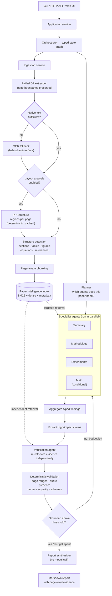
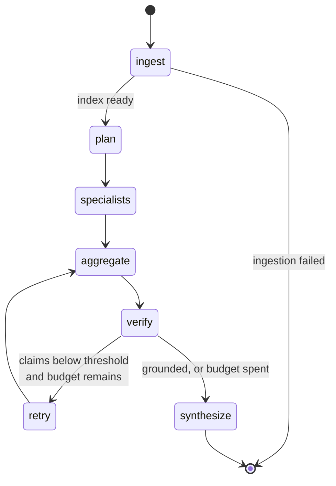

# PaperMind

**A verifiable, citation-grounded, multi-agent system for analysing research papers.**

[](https://github.com/Numaa-droid/Research_Paper_Intelligence/actions/workflows/tests.yml)


[](https://papermind-t344.onrender.com/)

> **[Live demo](https://papermind-t344.onrender.com/)**: sign in, upload a research-paper PDF and follow the agents live; the report cites a page and section for every grounded claim. The free server sleeps when idle, so the first load can take about a minute.

Built by **Saurabh Kadam** · [LinkedIn](https://www.linkedin.com/in/saurabh-kadam6998/) · [Portfolio](https://saurabh-portfolio-blush.vercel.app/) · [GitHub](https://github.com/Numaa-droid) · MIT [license](LICENSE)

*In the code, PaperMind keeps its working name: the `paperpilot` package and CLI, and `PAPERPILOT_*` settings.*

You give PaperMind one research-paper PDF. It parses and indexes the paper with
page-level metadata, plans an analysis, runs specialist agents over *targeted*
evidence, verifies high-impact claims against the original text, retries the
analyses that failed to ground, and produces a Markdown report in which every
important statement is either backed by a quote that was re-checked against the
PDF, or explicitly labelled as an inference, an uncertainty, or an unsupported
claim.

```
[p. 4, §4.2 Main Results, Table 1]
```

That is the unit of output. A citation appears only when the quote behind it was
found in the paper at that location.

---

## What this is, and what it is not

**It is** a domain-specific application for reading one research paper carefully.

**It is not** a judge of whether the paper is right. It knows nothing beyond the
PDF you submit and verifies claims **only against that paper's own text**, so it
cannot reproduce experiments or catch an error the paper does not itself reveal.

The design bet is narrow and testable: **factual grounding beats fluent prose.**
Where the two conflict, PaperMind reports the gap rather than writing around it.

---

## Architecture



### The state graph



The retry edge is a real cycle, bounded by `max_retries`. Only the agents that
failed to ground are re-run, and they are told exactly which claims were
rejected and why.

---

## Quick start

Requires **Python 3.11+**. Everything below runs offline with no credentials.

```bash
python3 -m venv .venv
source .venv/bin/activate
pip install -e ".[dev]"

# Generate the synthetic fixture paper
python fixtures/synthetic_paper.py fixtures/generated/synthetic_paper.pdf

# Analyse it
python -m paperpilot analyze fixtures/generated/synthetic_paper.pdf \
    --output ./reports/example.md
```

Run the test suite:

```bash
pytest                      # 697 tests, no network, no credentials (also run on GitHub Actions)
ruff check src tests        # lint
```

Start the API and web UI:

```bash
python -m paperpilot serve          # http://127.0.0.1:8000
```

### Using a real model

The default provider is a deterministic offline mock (see
[Model providers](#model-providers)). For a genuine analysis:

```bash
cp .env.example .env
# then set:
#   PAPERPILOT_LLM_PROVIDER=openai_compatible
#   PAPERPILOT_LLM_API_KEY=sk-...
#   PAPERPILOT_LLM_MODEL=gpt-4o-mini
python -m paperpilot analyze ./papers/your-paper.pdf -o ./reports/out.md
```

Any OpenAI-compatible endpoint works — hosted APIs, vLLM, LM Studio, or Ollama's
compatibility layer — by changing `PAPERPILOT_LLM_BASE_URL`.

For a local model through Ollama, e.g. `ollama pull qwen3.5:0.8b`:

```bash
# in .env:
#   PAPERPILOT_LLM_PROVIDER=openai_compatible
#   PAPERPILOT_LLM_BASE_URL=http://localhost:11434/v1
#   PAPERPILOT_LLM_MODEL=qwen3.5:0.8b
#   PAPERPILOT_LLM_REASONING_EFFORT=none   # thinking models otherwise return empty answers
```

To run an open-weights model from the Hugging Face Hub locally, with no API key:

```bash
pip install -e ".[local-llm]"
# in .env:
#   PAPERPILOT_LLM_PROVIDER=huggingface
#   PAPERPILOT_LLM_MODEL=ibm-granite/granite-4.1-3b
```

The weights (~6 GB for a 3B model) download on first use and run on CUDA, Apple
MPS or CPU (`PAPERPILOT_LLM_DEVICE`, default `auto`).

---

## CLI

```bash
# Full analysis
python -m paperpilot analyze paper.pdf --output report.md

# Also emit the complete structured result
python -m paperpilot analyze paper.pdf -o report.md --json-out result.json

# Parse and index only — no model calls. Useful for debugging extraction.
python -m paperpilot ingest paper.pdf
python -m paperpilot ingest paper.pdf --format json

# Serve the API and UI
python -m paperpilot serve --host 0.0.0.0 --port 8000

# Print a stored report
python -m paperpilot report analysis-abc123

# Parse any Markdown model answer into the response-document JSON (no model call)
python -m paperpilot parse answer.md

# Print the JSON Schema of that document
python -m paperpilot schema
```

Progress is printed per stage to stderr, the report goes to stdout (or
`--output`), and the exit code is non-zero on failure:

| Code | Meaning |
| --- | --- |
| `0` | analysis completed |
| `1` | analysis ran but did not complete |
| `2` | bad input (missing file, not a PDF, too large) |
| `130` | interrupted |

Useful flags: `--provider`, `--model`, `--max-retries`, `--sequential`
(disable parallel agents), `--no-ocr`, `--data-dir`, `-v`, `-q`, `--json-logs`.

---

## API

```
POST /papers                          upload a PDF          -> document_id
GET  /papers                          list documents
GET  /papers/{document_id}            document metadata
POST /papers/{document_id}/analyze    start analysis        -> analysis_id (202)
GET  /analyses/{analysis_id}          poll status and progress
GET  /analyses/{analysis_id}/report   the Markdown report
GET  /analyses/{analysis_id}/findings structured findings + verification
GET  /analyses/{analysis_id}/responses every model answer: Markdown + parsed JSON document
GET  /schemas/response-document       JSON Schema of the parsed model answer
GET  /analyses                        your analyses, newest first, with headline numbers
GET  /traces                          your run traces, newest first (running ones included)
GET  /traces/{trace_id}               one run: every span with inputs, outputs, tokens, timing
GET  /analyses/{analysis_id}/trace    the latest trace of an analysis
POST /auth/signup | /auth/login       create an account / sign in (sets the session cookie)
POST /auth/logout                     end the session
GET  /auth/me                         the signed-in account
POST /auth/password                   change password (signs out other sessions)
GET  /health                          liveness and configuration
GET  /                                minimal web UI
GET  /tracing                         trace viewer
```

```bash
# Sign in once; the response carries a session token for scripts.
TOKEN=$(curl -s -H 'Content-Type: application/json' \
  -d '{"email":"you@example.com","password":"..."}' localhost:8000/auth/login | jq -r .token)
AUTH="Authorization: Bearer $TOKEN"
DOC=$(curl -sH "$AUTH" -F "file=@paper.pdf" localhost:8000/papers | jq -r .document_id)
AID=$(curl -sH "$AUTH" -X POST localhost:8000/papers/$DOC/analyze | jq -r .analysis_id)

curl -sH "$AUTH" localhost:8000/analyses/$AID | jq '{status, progress, stage}'
curl -sH "$AUTH" localhost:8000/analyses/$AID/report
```

Every endpoint except `/`, `/tracing`, `/health`, the API docs and `/auth/*` needs a
signed-in account: the web UI uses an HttpOnly session cookie, scripts send the
token from `/auth/login` as `Authorization: Bearer <token>`. Each account sees
only its own papers and analyses; the first account created inherits anything
uploaded before accounts existed. Sign-up needs `PAPERPILOT_INVITE_CODE` when it
is set. Uploads and analysis starts are rate limited per account (`429` with
`Retry-After`), sign-in attempts per address, and an upload is cut off with
`413` as soon as it passes `PAPERPILOT_MAX_UPLOAD_MB`.

Analysis runs on a background worker and returns `202` immediately; poll
`GET /analyses/{analysis_id}` for `status`, `progress` (0–1) and the full event
stream. Pass `{"wait": true}` to the analyze endpoint to block instead — fine for
small papers, not recommended otherwise. Interactive docs are at `/docs`.

---

## Agent responsibilities

Each agent receives only the task, the paper metadata, and the evidence its own
retrieval queries returned. **No agent reads the whole PDF**, and no agent's prose
is passed to another agent — only validated Pydantic models cross node
boundaries.

| Agent | Responsibility | Activation |
| --- | --- | --- |
| **Planner** | Chooses which specialists this paper needs, and says why | always |
| **Summary** | Problem, motivation, contribution, data, method, results, limitations, assumptions | always (also the single-agent baseline) |
| **Methodology** | Inputs/outputs, architecture, training, inference, design decisions, prior-work comparison, execution flow | always |
| **Experiments** | Datasets, splits, baselines, metrics, results, ablations, hyperparameters, significance, whether the conclusions follow | when results content is detected |
| **Math** | Equations, variables, shapes, losses, objectives, author-stated derivations vs. the system's own reading | **conditional** — see below |
| **Verification** | Independently re-retrieves evidence for every high-impact claim and rules on it | always |
| **Synthesizer** | Renders the report from validated structures | always, **no model call** |

### Conditional math activation

The Math Agent runs when the paper actually contains mathematics. The decision is
deterministic, made from the index, and reported to the user:

1. **≥ `PAPERPILOT_MATH_MIN_EQUATIONS` equations detected** (default 3) → activate; or
2. **≥ 1 equation plus ≥ 2 mathematical phrases** ("loss function", "we minimise",
   "theorem", …) → activate; or
3. **≥ 4 mathematical phrases** even with no extractable equations → activate
   (this catches scanned papers whose equations did not survive extraction).

Otherwise it is skipped, and the report states the reason. The report always says
which agents ran and why.

---

## Evidence and verification design

### The paper intelligence layer

Before any agent runs, the paper is normalised into page-aware chunks:

```json
{
  "chunk_id": "paper-123-page-7-chunk-02",
  "document_id": "paper-123",
  "page": 7,
  "section": "4 Experiments",
  "subsection": "4.2 Main Results",
  "element_type": "table",
  "element_id": "table-3",
  "text": "...",
  "source": "native_text",
  "bbox": [72.0, 310.5, 523.0, 442.1],
  "confidence": 0.98
}
```

Two rules are absolute: **a chunk never spans a page boundary**, and **metadata
travels with the text everywhere**. That is what makes an honest page citation
possible at the other end of the pipeline.

> **Page numbering.** `page` is always the **1-based PDF page index**, never the
> printed page label. Where a PDF declares page labels they are preserved
> separately as `printed_label`. Every citation and every range check is defined
> against the PDF index, and the report says so.

### Retrieval

Hybrid: BM25 and dense vectors fused with reciprocal rank fusion, plus metadata
filtering by page, section and element type, and optional cross-encoder
reranking.

One non-obvious behaviour matters a lot in practice: **element cohesion**. A table
is split across a caption chunk and a body chunk. The caption is prose and wins on
lexical similarity, while the body holds the numbers — so retrieving one without
the other hands an agent a citation it cannot read a value out of. Retrieving
either pulls in the other.

### Verification

The verifier **re-retrieves evidence independently** of whatever the original
agent cited. If a claim only survives because the agent that wrote it also chose
its evidence, it has not been checked.

Two layers decide the verdict:

- a **deterministic layer** — page validity, quote presence, numeric equality —
  which can only *cap* a verdict, never inflate it; and
- the **model**, which judges semantic support.

Where they disagree, the deterministic layer wins. A number that is not in the
paper is not in the paper, however confident the model sounds.

| Status | Meaning |
| --- | --- |
| `supported` | the evidence directly asserts the claim |
| `partially_supported` | the evidence supports only part of it |
| `unsupported` | no adequate evidence was found |
| `contradicted` | the evidence conflicts with the claim |
| `inferred` | a reasonable reading, not stated by the authors |
| `unknown` | verification could not be completed |

### Model answers: Markdown in, deterministic JSON out

Models never write JSON. A JSON answer fails the whole agent on one misplaced
comma or a response cut off at the token limit, so every prompt instead asks for
Markdown in a fixed layout — headings name fields, tables carry rows, blockquotes
carry evidence:

```markdown
## Reported Results
| System | Dataset | Metric | Value | Source | Quote |
| --- | --- | --- | --- | --- | --- |
| SRT-Large | NarrativeQA | F1 | 81.4 | [S3] |  |

## Findings
### Finding 1
- Claim: SRT-Large reaches 81.4 F1 on NarrativeQA.
- Status: supported
> [S3] SRT-Large reaches 81.4 F1 while reducing attention FLOPs by 3.1x
```

`paperpilot.response.parse_markdown` turns that into a **response document**
(CommonMark + GFM tables, via markdown-it). The same Markdown always yields the
same JSON, and any text — even malformed or truncated — parses without raising:

| Node | What it carries |
| --- | --- |
| `Section` | `heading`, normalised `key`, `level`, `path`, `blocks`, `subsections` |
| `ParagraphBlock`, `ListItem` | `text`, verbatim `markdown`, `citations`; list items also `key`/`value` for `- Key: value` |
| `TableBlock` | `columns` (`column_index`, `header`, `key`, `alignment`) and `rows` |
| `TableCell` | `row_index`, `column_index`, `column_header`, `row_header` (first column), `value`, `number`, `unit`, `strong`, `citations` |
| `BlockquoteBlock`, `CodeBlock`, `MathBlock` | source text kept verbatim, so quotes and equations are never altered by rendering |

The JSON Schema is published at `docs/schemas/response-document.schema.json`
(`paperpilot schema` regenerates it). Every agent result stores both
`response_markdown` and `response_document`.

Two further properties make this robust to real model output:

- **Citations are labels, not locations.** The context block numbers each
  retrieved chunk `S1`, `S2`, …; the model cites `[S3]` and page, section,
  element id and chunk id are filled in from the index. A wrong label is
  recovered by locating the quote in the paper, and noted.
- **Tolerant, but never guessing.** Numbered or bold pseudo-headings, `**Key:**`
  bullets, trailing citations, `80%`/`high` confidences and a code fence around
  the whole answer are all read. A table row with an unescaped `|` keeps its text
  (merged into the last column, with a warning) instead of losing cells. A field
  that is absent is empty — it is never inferred.

### Deterministic validation

None of the following is delegated to a model, because all of it has an exact
answer given the index:

- page numbers within the document range;
- evidence quotes actually occurring in the cited text;
- section and element references resolving against the index;
- numeric values matching their own evidence;
- required fields and confidence ranges;
- retry limits, file type and file size.

Quote matching runs in tiers: **exact** → **normalized** (whitespace/punctuation)
→ **approximate** (fuzzy, which is what OCR output usually manages) →
**unverifiable**. Each tier costs confidence. An approximate match is kept and
*labelled*; an unverifiable one never renders as a citation.

The policy throughout is **annotate and downgrade, never silently delete**. A
citation that fails validation appears in the evidence appendix marked as
unverifiable, because dropping it would hide the failure from you.

### Retries

After verification, an agent is re-run when it failed outright, produced nothing,
or grounded less than `verification_threshold` of its claims. It is re-run with
feedback naming the rejected claims. An agent is never retried twice, and the
whole loop stops at `max_retries`.

---

## Model providers

Every model call goes through one interface, so the system runs and is fully
testable without credentials.

| Provider | Use |
| --- | --- |
| `mock` (default) | Deterministic, offline. **Not a language model.** |
| `openai_compatible` | Any OpenAI-compatible chat-completions endpoint |
| `huggingface` | Open-weights Hub model run in-process with `transformers` |

The mock is not a stub that returns fixed strings: it reads the retrieved
evidence and builds answers out of verbatim sentences from it, so the real
pipeline — quote validation, numeric checking, citation rendering — is exercised
end to end. It also **deliberately emits one ungrounded claim per run**, because a
verifier that is never handed a bad claim has not been tested.

Reports, the CLI and `/health` all state plainly when the mock was used.

Embeddings follow the same pattern: `hashing` (deterministic, offline, limited
quality), `openai_compatible`, or `sentence_transformers`.

---

## Evaluation

```bash
# Benchmark PDFs are generated, not committed — build the fixture first.
python fixtures/synthetic_paper.py fixtures/benchmark/synthetic_paper.pdf

python scripts/evaluate.py --papers ./fixtures/benchmark --output ./eval_results
```

Drop PDFs into the papers directory and describe them in `expectations.json`:

```json
{
  "papers": [
    {
      "filename": "your-paper.pdf",
      "expected_claims": ["a fact a competent analysis should surface"],
      "key_numbers": ["81.4"]
    }
  ]
}
```

| Metric | Definition |
| --- | --- |
| **Claim coverage** | Expected claims that appear in the report |
| **Citation precision** | Citations whose quote is genuinely at the cited location |
| **Citation recall** | Factual claims carrying at least one verified citation |
| **Numeric accuracy** | Numbers in claims that occur in the paper |
| **Unsupported-claim rate** | Findings that failed to ground |
| **Verification accuracy** | Verifier verdicts agreeing with a deterministic re-check |
| **Latency** | End-to-end seconds per paper |
| **Estimated cost** | Model spend, where the provider publishes pricing |

Every metric is computed **without a model**, so results are comparable across
providers. Metrics needing ground truth report `n/a` when none is supplied rather
than inventing a score. Claim coverage and verification accuracy are the two to
read together: a system that never admits doubt scores a perfect
unsupported-claim rate while being less trustworthy.

Raw outputs, normalised findings, verification results and aggregates are written
separately so a run can be re-scored without paying for the model calls again.

---

## Configuration

All configuration is environment-driven; see `.env.example` for the full list.
Secrets are never logged — `Settings.redacted()` masks them.

| Variable | Default | Purpose |
| --- | --- | --- |
| `PAPERPILOT_LLM_PROVIDER` | `mock` | `mock`, `openai_compatible` or `huggingface` |
| `PAPERPILOT_LLM_MODEL` | `gpt-4o-mini` | Model name, or Hub repo id for `huggingface` |
| `PAPERPILOT_LLM_DEVICE` | `auto` | `huggingface` only: `auto`, `cpu`, `mps`, `cuda` |
| `PAPERPILOT_LLM_BASE_URL` | OpenAI | Any compatible endpoint |
| `PAPERPILOT_LLM_API_KEY` | — | Never commit this |
| `PAPERPILOT_EMBEDDING_PROVIDER` | `hashing` | `hashing`, `openai_compatible`, `sentence_transformers` |
| `PAPERPILOT_INVITE_CODE` | — | Code required to create an account; unset lets anyone sign up (warned at startup and in `/health`) |
| `PAPERPILOT_RATE_LIMIT_REQUESTS` | `60` | Uploads + analysis starts per account per window; `0` disables |
| `PAPERPILOT_RATE_LIMIT_WINDOW_SECONDS` | `3600` | Rate-limit window |
| `PAPERPILOT_MAX_UPLOAD_MB` | `50` | Upload size limit, enforced while the upload streams in |
| `PAPERPILOT_OCR_ENABLED` | `true` | Send pages that fail the extraction check to PaddleOCR-VL |
| `PAPERPILOT_OCR_BASE_URL` | `http://127.0.0.1:8080/v1` | llama-server endpoint running PaddleOCR-VL |
| `PAPERPILOT_OCR_FIGURES_ENABLED` | `true` | Also read charts and diagrams on text pages |
| `PAPERPILOT_OCR_TABLES_ENABLED` | `true` | Re-read tables for their headers and cell grid |
| `PAPERPILOT_OCR_MIN_CHARS_PER_PAGE` | `180` | Below this, a page fails the extraction check |
| `PAPERPILOT_LAYOUT_ENABLED` | `false` | Analyse page layout with PP-Structure |
| `PAPERPILOT_LAYOUT_MODEL` | `PP-DocLayout_plus-L` | Pinned layout detector |
| `PAPERPILOT_LAYOUT_DPI` | `200` | Rasterisation DPI; part of the layout cache key |
| `PAPERPILOT_LAYOUT_CACHE_DIR` | `data/layout_cache` | Analysed pages, keyed by image + config |
| `PAPERPILOT_CHUNK_MAX_CHARS` | `1200` | Chunk size |
| `PAPERPILOT_RETRIEVAL_TOP_K` | `8` | Chunks per query |
| `PAPERPILOT_MAX_RETRIES` | `1` | Retry budget |
| `PAPERPILOT_VERIFICATION_THRESHOLD` | `0.85` | Grounding rate below which an agent is retried |
| `PAPERPILOT_MATH_MIN_EQUATIONS` | `3` | Math Agent activation threshold |
| `PAPERPILOT_PARALLEL_AGENTS` | `true` | Run specialists concurrently |
| `PAPERPILOT_DATA_DIR` | `./data` | Uploads, indexes, reports, SQLite |
| `PAPERPILOT_DATABASE_URL` | local SQLite | `sqlite:///path` or `postgresql://…` (e.g. Supabase) |
| `PAPERPILOT_DATABASE_SCHEMA` | `paperpilot` | PostgreSQL only: schema for PaperMind's tables |
| `PAPERPILOT_LOG_FORMAT` | `json` | `json` or `text` |

### Database: SQLite or Supabase

Records (accounts, sessions, papers, analyses) live in SQLite by default. To use
Supabase (or any PostgreSQL 13+):

```bash
pip install -e ".[postgres]"
# .env — Supabase: Project → Connect → Session pooler, with your database password
PAPERPILOT_DATABASE_URL=postgresql://postgres.<ref>:<password>@aws-0-<region>.pooler.supabase.com:5432/postgres

python -m paperpilot migrate-db --from ./data/paperpilot.sqlite   # optional: bring existing data
make serve
```

Tables are created on first start in their own `paperpilot` schema, with
row-level security on and no policies, so Supabase's public Data API (the anon
key) cannot read them; the server connects as their owner. Uploaded PDFs and
reports still live in `PAPERPILOT_DATA_DIR`. The storage tests run against
PostgreSQL too when `PAPERPILOT_TEST_DATABASE_URL` is set.

### Security

- The API refuses calls without a session before reading their body. Passwords
  are hashed with scrypt; only a SHA-256 of each session token is stored. The
  session cookie is HttpOnly and SameSite=Lax (and Secure over HTTPS), and no
  CORS headers are sent, so other sites cannot act with a visitor's session.
- Set `PAPERPILOT_INVITE_CODE` before exposing the port beyond your machine.
- Sign-in attempts are rate limited per client IP. Behind a reverse proxy, run
  uvicorn with `--proxy-headers` so the client IP is the real one.
- PDFs are validated by extension, magic header and size **before parsing**.
- Uploaded filenames are reduced to a basename and sanitised; traversal is not
  possible.
- Document content is never executed, and links inside PDFs are never followed.
- Document text is not logged by default — events reference document and chunk
  ids (`PAPERPILOT_LOG_DOCUMENT_TEXT`).
- `.gitignore` excludes `.env`, uploads, indexes, generated reports and local
  databases.

---

## Observability

Structured JSON events, one per line, for: ingestion start/finish, page and chunk
counts, OCR pages, every retrieval query and its result count, agent start/finish
with token usage and prompt version, every verification outcome, every retry, the
final report, and all errors. Each carries the `analysis_id` and `document_id`
for correlation.

Agent traces record the **agent name, prompt version, model, provider, attempt,
token usage and latency**, so a change in output quality can be attributed to a
prompt change rather than guessed at.

### Run tracing (`/tracing`)

A self-hosted alternative to LangSmith: every analysis is recorded as a tree of
spans and shown in a trace viewer at **`/tracing`** (also linked from the
sidebar, and as *View trace* on every run). Nothing leaves the machine.

| Span kind   | What it records |
|-------------|-----------------|
| `chain`     | the run itself (paper, model, final status), and each agent's context assembly |
| `node`      | every graph node, in execution order, with what it wrote to the state; parallel groups contain their members |
| `agent`     | each specialist and each verified claim: inputs (attempt, retry feedback), findings out |
| `retriever` | every search query with the ranked chunks it returned (page, section, scores, text) |
| `llm`       | every model call: system and user prompt, the answer, tokens, latency, estimated cost |
| `parser` / `tool` | Markdown parsing, evidence validation, PDF parsing, chunking, indexing |

Routing decisions (`verify → retry`) and every INFO-or-louder log line are kept
as events on the span that was open when they happened. A running analysis is
traceable live: the viewer polls and shows steps still in flight.

The viewer opens on a **runs overview**: headline numbers, a chart of latency,
tokens, LLM calls, cost or errors per run, and a runs table with each run's
input, output, latency, tokens and cost. Opening a run shows its **timeline**
(span tree beside a waterfall of when each step ran), its **agent flow** (the
graph as it actually executed, with a per-agent breakdown of time, calls and
tokens), and an inspector with a step's input, output, metadata, events and
error. Traces download as JSON, and `/tracing#<trace_id>/<span_id>` links to one step.

The run page shows the same data in place: click any stage of the graph and its
inspector lists what happened **under the hood** — each search query and the
chunks it returned, each model call with its tokens, parsing and validation,
every verified claim — with the model's answer, and links to that step in the
trace viewer. The **Trace** button beside *Replay* opens the whole run.

Traces are stored in `<data_dir>/traces.sqlite`, the newest
`PAPERPILOT_TRACING_RETENTION` (default 200) kept. They contain paper text
(prompts and retrieved passages); `PAPERPILOT_TRACING_CAPTURE_CONTENT=false`
keeps only their sizes. `PAPERPILOT_TRACING_ENABLED=false` turns tracing off.
To trace your own code, wrap it in `paperpilot.tracing.span(name, kind=...)`;
outside a run it does nothing.

---

## Repository layout

```
src/paperpilot/
├── api/              FastAPI routes, schemas, background tasks
├── agents/           Summary · Methodology · Experiments · Math · Verification
│   └── prompts/      Versioned prompts, shared grounding rules
├── domain/           Enums, Pydantic contracts, orchestrator state
├── evaluation/       Metrics and the benchmark harness
├── ingestion/        PDF parsing, OCR, structure detection, chunking
├── orchestration/    Planner, state graph engine, retries, events
├── providers/        LLM and embedding adapters (incl. the mock)
├── reporting/        Citation formatting, report synthesis
├── response/         Markdown model answers -> deterministic response-document JSON
├── retrieval/        BM25, vectors, the paper index, hybrid retriever
├── storage/          Repository interfaces, SQLite, local files
├── tracing/          Span tracer, trace store, traced LLM provider
├── validation/       Quote matching, numeric checks, schema coercion
├── cli.py            Command-line interface
└── service.py        Application service
```

---

## Known limitations

These are real, and worth stating plainly:

- **Structure detection is heuristic.** Multi-column layouts, rotated tables and
  unusual templates degrade section and element detection. `paperpilot ingest`
  exists so you can inspect exactly what was extracted.
- **Table *values* are indexed as text**, not parsed into a cell grid. Numbers are
  checked against the text, so a value in a badly-extracted table may be
  unverifiable even though it is correct in the PDF.
### Layout analysis (optional)

PyMuPDF reports the blocks a PDF's content stream declares. On many journal
templates that is one block per column run, with a section heading, its
paragraph and a figure caption fused into a single object — so the real headings
are invisible to any "short line" test, and the only heading-shaped blocks left
on the page are running heads, chart titles and table column headers. PaperMind
recovers the structure from line geometry by default, which handles this; where
it does not, a layout model can be asked what the page actually contains.

```bash
pip install -e ".[layout]"
paperpilot ingest --layout paper.pdf
```

Each page is rasterised and run through PP-Structure, and the text blocks are
re-cut along the regions it reports: lines in a title region become a heading
whatever their typography, lines in a header or footer region are dropped as
page furniture, and a caption is separated from the paragraph beneath it. Pages
the model does not analyse fall back to the geometric heuristics, so no text is
ever lost to a failed page.

It costs a rasterise and a model pass per page, which is why it is off by
default. **It is deterministic**: one CPU thread, fixed seeds, a pinned model, a
fixed DPI, coordinates quantised before anything sorts or compares them, a total
order over regions that never depends on detection order, and an on-disk cache
keyed by the page image *and* the full engine configuration. The same PDF yields
a byte-identical report on every run, with the cache cold, warm, or disabled.

- **OCR pages are approximate by construction.** Quotes from them match fuzzily
  and carry reduced confidence. OCR is done by PaddleOCR-VL-1.6, served locally:

  ```bash
  brew install llama.cpp
  hf download PaddlePaddle/PaddleOCR-VL-1.6-GGUF --local-dir ~/models/paddleocr-vl
  make ocr-server   # keep running alongside `paperpilot serve`
  ```

  Extraction is routed per page and per region. Every page's text layer goes
  through a deterministic extraction check; a page fails it when the layer is
  thin, mostly symbols, full of glyphs the font could not map to Unicode,
  garbled (non-words, or words run together with no spaces), or laid over a
  full-page scan. Failed pages are read whole by the model and its reading is
  used as-is; if the model is unreachable the native text is kept at confidence
  0.4. Pages that pass keep PyMuPDF's text layer; charts
  and diagrams on text pages (embedded images, or vector drawings that are not
  ruled tables) are cropped and read by the model as `figure` chunks linked to
  their caption. Chart values are indexed only when printed in the figure — the
  model estimates unlabelled bars and invents numbers for diagrams, and neither
  may reach the verifier as something the paper states.

  Tables are found from their `Table N:` captions and the rules drawn around
  them, and re-read with `Table Recognition:` to recover what PyMuPDF loses —
  merged headers, cell order, superscripts. The model's table replaces the
  native text only when every numeric cell's digits and ~80% of its words match
  the text layer; otherwise the native text is kept, so a misread digit is never
  indexed.
- **The default hashing embedder is weak.** It is deterministic and offline, which
  is right for tests; use a real embedding provider for real retrieval quality.
- **Equations are preserved, not understood.** Anything that does not survive
  extraction legibly is marked `unavailable` and never reconstructed.
- **Verification is internal only.** It checks a claim against *this paper*. It
  cannot tell you the paper is wrong.
- **One paper at a time.** No cross-paper search, no web access, no code
  execution.
- **Claim coverage needs human ground truth.** Without `expectations.json` that
  metric is `n/a`.

## Future extensions

Multi-paper comparison and citation-graph traversal; a real table parser feeding
cell-level numeric verification; layout-aware parsing for multi-column PDFs;
figure understanding; PostgreSQL and object-storage adapters (the repository
interfaces are already in place); a Redis-backed queue for concurrent analyses;
per-agent prompt A/B evaluation using the existing harness.

---

## In one paragraph

> PaperMind is a domain-specific, citation-grounded multi-agent system. Its
> Orchestrator dynamically decomposes paper analysis, routes targeted evidence to
> specialized agents, verifies high-impact claims against the original paper, and
> retries weak analyses before producing a structured report.

## License

[MIT](LICENSE) © 2026 Saurabh Kadam
